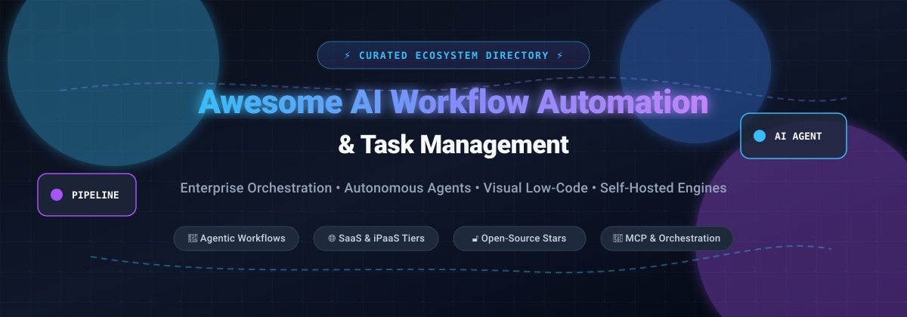

  

# Awesome AI Workflow Automation & Task Management 🚀 🌟

  
  
  
  
  
  

> 🤖 **Curated directory of the best AI workflow automation engines, agentic orchestration frameworks, iPaaS tools, and task management platforms.**  
> 🔍 *Covers both leading commercial SaaS ecosystems and self-hostable open-source solutions.*  
> ⭐ **Star this repository if you find it helpful!**

---

## 📌 Table of Contents
- [📖 Overview & Key Concepts](#-overview--key-concepts)
- [📊 Sector Overview & Market Dynamics](#-sector-overview--market-dynamics)
- [☁️ SaaS / Hosted Platforms](#️-saas--hosted-platforms)
- [🔓 Open-Source GitHub Projects](#-open-source-github-projects)
- [💡 Architectural Patterns & Combinations](#-architectural-patterns--combinations)
- [🤝 How to Contribute](#-how-to-contribute)
- [💖 Support](#-support)
- [📈 Star History](#-star-history)
- [⚠️ Disclaimer](#️-disclaimer)

---

## 📖 Overview & Key Concepts

**AI Workflow Automation & Task Management** platforms empower software engineers, data professionals, and operations teams to bridge enterprise applications, orchestrate autonomous multi-agent systems, and automate multi-step processes with human-in-the-loop oversight. 

Modern architectures in this domain span:
- **Autonomous Agentic Orchestration**: Multi-harness AI workers executing multi-step reasoning, tool invocations, and dynamic code execution.
- **Model Context Protocol (MCP)**: Universal standardized integration enabling AI agents to query external tools, resources, and task backends securely.
- **Visual Flow Builders**: Drag-and-drop scenario builders with deterministic routers, iterators, conditional branching, and error handlers.
- **Self-Hosted Data Sovereignty**: Air-gapped, on-premise execution engines preventing third-party data leakage and token consumption bloat.

---

## 📊 Sector Overview & Market Dynamics

The global AI workflow automation and iPaaS market is valued at approximately **$12B to $17B** and is projected to expand beyond **$100B+** over the next decade (growing at a 25%–35% CAGR) as enterprises shift from static API triggers to autonomous agentic orchestration. The sector is **concentrated at the enterprise tier**—dominated by well-capitalized leaders and cloud hyperscalers—yet remains **highly fragmented at the innovation frontier**, where rapid emergence of open-source frameworks, agent-native engines, and Model Context Protocol (MCP) integrations prevents any single platform from capturing a winner-take-all monopoly.

---

## ☁️ SaaS / Hosted Platforms

Leading commercial AI workflow automation and iPaaS platforms, sorted by enterprise scale (valuation / revenue):

| 🏢 Product | 📈 Company Size (Valuation / Revenue) | 💰 Pricing (Starting Tier) | 🎁 Free Tier Limits | ⚙️ Architecture & Features |
| :--- | :--- | :--- | :--- | :--- |
| **[Make (Celonis)](https://www.make.com/)** | **$11B – $13B valuation** (Celonis); ~$400M+ revenue | **$9.00/mo** (Core plan, billed annually) or $10.59/mo monthly | **1,000 operations/month**, 2 active scenarios, 15-minute execution interval, 500 MB data transfer limit | Visual scenario builder with routers, iterators, aggregators, and data mapping. Billing counts module operations. |
| **[Workato](https://www.workato.com/)** | **$5.7B valuation** (peak) / ~$150M+ ARR | **$75.00/mo** (Pro base) / enterprise quote (~$20k–$50k+/yr) | **30-day free trial** (restricted sandbox, baseline credits upon approval; no permanent free tier) | Enterprise low-code iPaaS with 1,200+ connectors, Recipe IQ, and governance. |
| **[n8n Cloud](https://n8n.io/)** | **$5.2B valuation** (SAP strategic round); €100M+ ARR | **$20.00/mo** (Starter plan, billed annually as €20/mo) | **14-day free trial** (1,000 workflow executions limit, 5 concurrent executions; no permanent cloud free tier) | Managed cloud edition of n8n. Charges per complete execution rather than step-by-step actions. |
| **[Zapier](https://zapier.com/)** | **$5.0B valuation**; ~$310M+ ARR | **$19.99/mo** (Professional plan, billed annually) or $29.99/mo monthly | **100 tasks/month**, single-user seat, 2-step Zaps only (1 trigger, 1 action), 15-minute polling interval | Accessible no-code platform with 9,000+ connectors. Bills per successful action step. |
| **[Tray.io (Tray.ai)](https://tray.ai/)** | **$600M+ valuation**; ~$70.9M ARR | **$50.00/mo** (Starter usage tier) / custom mid-market | **14-day free trial** (capped task execution volume, builder testing; no permanent free tier) | Enterprise iPaaS with Merlin Agent Builder and autonomous agentic workflows. |
| **[Pipedream](https://pipedream.com/)** | **$80M valuation** (acquired by Workday); $22.4M funding | **$99.00/mo** (Startup plan, billed annually) or $150/mo monthly | **Free forever plan**: Unlimited workflows, daily free compute credits, 750 seconds of test runtime/day (development mode) | Developer-centric integration platform combining prebuilt components with custom code (Node, Python, Go, Bash). |

---

## 🔓 Open-Source GitHub Projects

Self-hostable, community-driven workflow automation and AI task orchestration systems, sorted by GitHub_Stars:

| 📦 Project | 🌟 GitHub_Stars | 🎯 Focus & Architecture | 📜 License |
| :--- | :--- | :--- | :--- |
| **[n8n](https://github.com/n8n-io/n8n)** |  | Source-available node-based workflow automation engine with 400+ nodes, built-in AI Agent node, and execution-based licensing. | Sustainable Use (Fair-code) |
| **[Dify](https://github.com/langgenius/dify)** |  | Open-source LLMOps platform combining visual prompt engineering, workflow orchestration, 260+ plugins, and multi-agent systems. | Apache-2.0 |
| **[Langflow](https://github.com/langflow-ai/langflow)** |  | Visual IDE for multi-agent workflows with direct Python source access, native MCP server export, and desktop runtime. | MIT |
| **[Flowise](https://github.com/FlowiseAI/Flowise)** |  | Visual canvas for building AI agents with Chatflows, Agentflows, RAG pipelines, and human-in-the-loop review capabilities. | Apache-2.0 |
| **[Huginn](https://github.com/huginn/huginn)** |  | Hackable agent-based system for monitoring events and automating tasks online (a self-hosted IFTTT/Zapier alternative). | MIT |
| **[Directus](https://github.com/directus/directus)** |  | Modular data platform with automated event-driven workflows (Flows), custom hooks, webhooks, and AI operation extensions. | BSL / GPL-3.0 |
| **[Kestra](https://github.com/kestra-io/kestra)** |  | Event-driven, declarative YAML orchestrator for microservices, data, and agentic workflows with embedded code runners. | Apache-2.0 |
| **[Activepieces](https://github.com/activepieces/activepieces)** |  | No-code, open-source automation engine designed as an open Zapier alternative with 200+ pieces, AI actions, and self-hosting. | MIT / EE |
| **[Prefect](https://github.com/PrefectHQ/prefect)** |  | Modern Python workflow orchestration engine for coordination of async tasks, LLM evaluation pipelines, and scheduled automations. | Apache-2.0 |
| **[Windmill](https://github.com/windmill-labs/windmill)** |  | Developer platform that converts scripts (Python, TypeScript, Go, Bash, SQL) into internal tools, endpoints, and multi-step workflows. | AGPL-3.0 / Enterprise |
| **[Automatisch](https://github.com/automatisch/automatisch)** |  | Privacy-first open-source Zapier alternative to automate business processes without vendor lock-in or GDPR violations. | AGPL-3.0 |
| **[Vikunja](https://github.com/go-vikunja/vikunja)** |  | Self-hosted task and project management backend with native Model Context Protocol (MCP) support for agentic task execution. | AGPL-3.0 |
| **[SoduWork](https://github.com/mdiri-ai/SoduWork)** |  | Multi-harness, multi-agent AI engine with human-in-the-loop audit trail, portable method plugins, and independent review. | MIT |

---

## 💡 Architectural Patterns & Combinations

When engineering robust AI task automation stacks:
- **Deterministic Orchestration + AI Agents**: Combine **n8n** or **Kestra** for reliable trigger/schedule workflows with **Flowise** or **Dify** for reasoning and prompt chains.
- **Model Context Protocol (MCP) Integration**: Connect agentic frameworks directly with **Vikunja** or **Directus** as structured task backends, allowing agents to manipulate tasks via standardized APIs.
- **Human-in-the-Loop Verification**: Leverage **SoduWork** or **Flowise** review gates before triggering destructive API calls or outbound communications.

---

## 🤝 How to Contribute

Contributions are warmly welcome! 🛠️

1. 🍴 **Fork** the repository.
2. 🌿 Create your feature branch (`git checkout -b feature/new-tool`).
3. 📝 Add your entry under the relevant section with factual descriptions, pricing tiers, and official links.
4. 📬 Submit a **Pull Request** detailing why the tool is valuable for the community.

---

## 💖 Support

If you found this curated list helpful, please consider supporting the project:

- ⭐ **Star** this repository on GitHub!
- 🍴 **Fork** and share it with colleagues and communities.
- ☕ **Buy me a coffee**: You can sponsor or support ongoing curation via the [GitHub Sponsors Dashboard](https://github.com/sponsors/ishandutta2007).

Thank you for being part of the open automation and agentic AI community! 🙌

---

##  Star History

---

## ⚠️ Disclaimer

- This is an independent **community-curated** directory for research and architectural evaluation.
- Inclusion does not imply official endorsement or sponsorship by any referenced vendor.
- AI workflows execute actions with linked credentials; always enforce least-privilege API scopes, audit trails, and human verification checkpoints for sensitive operations.
- Always check official vendor portals for real-time tier updates and license agreements.
